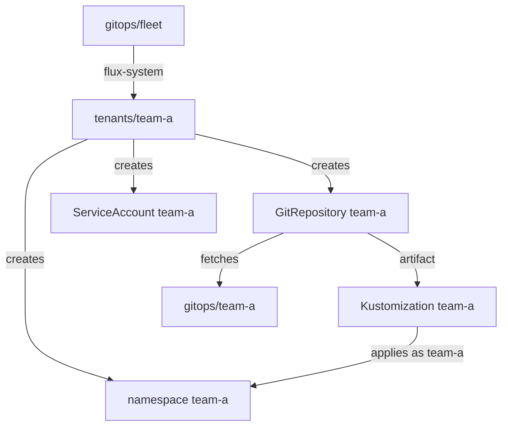

# Platform Administrators, Tenants And Their Repositories

Before you can limit what a team may do, you need a clear line between the people who own the cluster and the people who only use part of it. This part draws that line. It shows who owns which repository, where each Flux object lives, and what Flux needs to know about a new team. It ends with the objects `flux create tenant` generates for you.

## Two roles, two kinds of repository

Multi-tenancy in Flux has two roles. The **platform administrator** owns the cluster. They bootstrapped Flux, they own the platform repository that Flux reconciles itself from, and they decide which teams exist. A **tenant** is a team that gets its own namespaces and its own Git repository, and may change nothing else on the cluster.

Each role has its own repository. In your playground, the platform repository is `gitops/fleet` and the tenant repository is `gitops/team-a`. The platform repository says *that* `team-a` exists and *where* its files come from. The tenant repository says *what* `team-a` runs. The tenant can merge whatever it likes into its own repository, because the platform decides what those files are allowed to change.



The diagram shows the chain: the platform repository creates the tenant's namespace, ServiceAccount, `GitRepository` and Flux `Kustomization`, and that `Kustomization` applies the tenant's own files into the tenant's namespace, acting as the tenant's ServiceAccount.

## Look at the two repositories

The platform repository already follows the layout every Flux cluster uses. Start the port-forward in a second terminal if it is not running, then clone both repositories into a working folder. The username and password are the lab-only `gitops` and `gitops-password`, and `git` asks for them on the first clone:

<!-- astrona:playground:renew -->

```sh
git clone http://gitea.localtest.me:3000/gitops/fleet.git
git clone http://gitea.localtest.me:3000/gitops/team-a.git
find fleet -name '*.yaml' -not -path '*/.git/*' | sort
find team-a -name '*.yaml' -not -path '*/.git/*' | sort
```

The `fleet` listing shows `apps/podinfo/` with the platform's own application, and `clusters/kind/` with `podinfo.yaml` and the `flux-system/` folder that `flux bootstrap` wrote. There is no `tenants/` folder yet, because no tenant exists. The `team-a` listing shows two folders: `app/`, with a Deployment and a Service for podinfo, and `escalate/`, with a ClusterRole that grants every permission. The second folder is there so you can watch Kubernetes refuse it later.

Notice that the files in `team-a/app` name no namespace. The platform decides the namespace, with the field `targetNamespace` on the tenant's Flux `Kustomization`. A tenant cannot then send its objects into someone else's namespace by writing `namespace: podinfo` in a file, because Flux sets the namespace before it applies.

## What Flux applies with today

Right now every Flux `Kustomization` in the playground is applied by kustomize-controller with its own ServiceAccount, `kustomize-controller` in the namespace `flux-system`. Flux binds that ServiceAccount to the ClusterRole `cluster-admin` when it is installed. List the cluster-wide bindings that mention the Flux controllers:

```sh
kubectl get clusterrolebindings -o wide | grep flux-system
```

One of the lines binds `cluster-admin` to the ServiceAccounts `kustomize-controller` and `helm-controller` in `flux-system`. That is the reason Flux can apply anything at all, and the reason a tenant's repository must not be applied with it.

## What a tenant needs

A new tenant needs three objects before Flux can apply its files safely: a **Namespace** for its workloads, a **ServiceAccount** for Flux to impersonate, and a **RoleBinding** that gives that ServiceAccount rights inside the namespace only. The Flux command-line tool can generate all three. It is marked as a preview command, so check its output before you use it:

```sh
flux create tenant team-a --with-namespace=team-a --export
```

The command prints a Namespace `team-a`, a ServiceAccount `team-a` in that namespace, and a RoleBinding in that namespace. The RoleBinding binds the ClusterRole `cluster-admin`, the default of the flag `--cluster-role`, to the ServiceAccount. Nothing is created in the cluster, because `--export` only prints YAML.

Binding `cluster-admin` sounds dangerous, but the kind of binding decides the scope. A **RoleBinding** grants the rules of a ClusterRole inside its own namespace only. A **ClusterRoleBinding** grants them everywhere. So `team-a` gets every right inside `team-a` and no right anywhere else. The course writes these three objects by hand, so you see every field, but the result is the same.

You now know who owns which repository, why Flux can currently apply anything, and which three objects keep a tenant inside its namespace. The question still open is how to make Flux actually use the tenant's ServiceAccount instead of its own.

## Common pitfalls

> [!WARNING]
> - **Putting tenant objects in the tenant's own repository.** The namespace, the ServiceAccount, the RoleBinding and the tenant's Flux objects belong in the platform repository. A tenant that controls its own RoleBinding controls its own rights.
> - **Binding the tenant with a ClusterRoleBinding.** `cluster-admin` through a ClusterRoleBinding gives the tenant the whole cluster. Through a RoleBinding it gives the tenant one namespace.
> - **Trusting the namespace in a tenant's files.** Set `targetNamespace` on the tenant's Flux `Kustomization`, so the platform decides where objects land.
> - **Forgetting that `flux create tenant` is a preview command.** Read what `--export` prints before you commit it.
