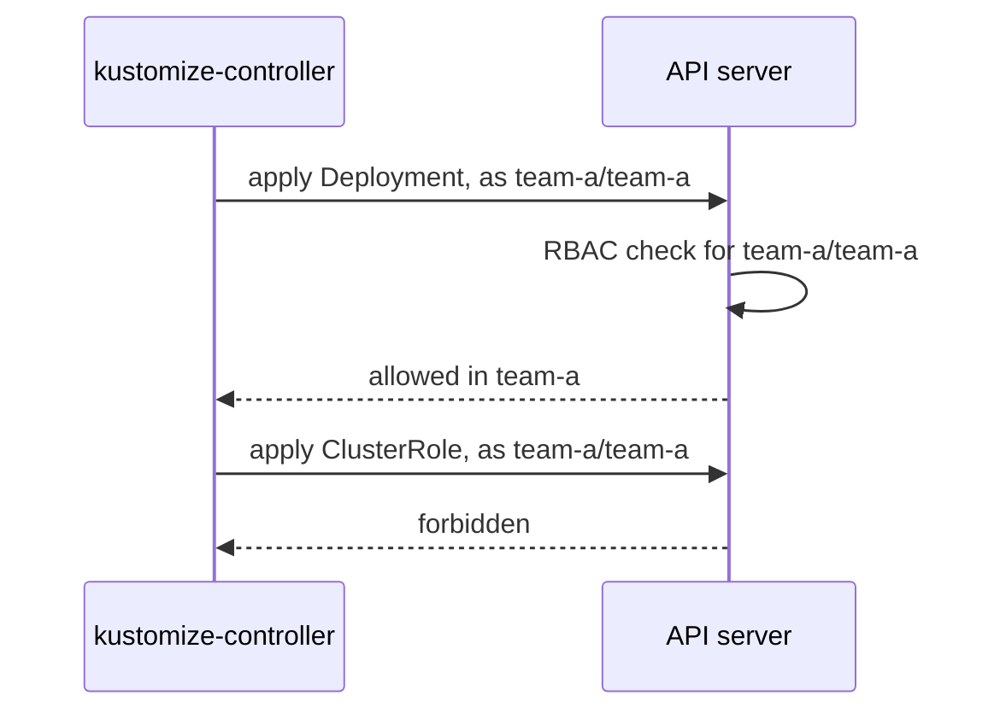

# Impersonation With spec.serviceAccountName

A ServiceAccount with narrow rights is no use until Flux acts as it. This part onboards the tenant `team-a` through Git, makes its Flux `Kustomization` impersonate the ServiceAccount `team-a`, and then tries to create a cluster-wide object as that account. Kubernetes refuses it, and you learn where Flux shows that refusal.

## How impersonation works

**Impersonation** is a Kubernetes feature: a client that holds the right to impersonate may send a request "as" another user or ServiceAccount. The API server then checks the request against that account's permissions, not the client's. kustomize-controller holds that right. When a Flux `Kustomization` sets `spec.serviceAccountName`, kustomize-controller applies every object of that `Kustomization` as the named ServiceAccount, in the `Kustomization`'s own namespace.



The diagram shows kustomize-controller sending each object as `team-a/team-a`: the API server allows the Deployment in the tenant's namespace and refuses the ClusterRole, which only a cluster-wide right could create.

## Onboard team-a through Git

The tenant's objects go in the platform repository, in a folder of their own. Work in the clone of `fleet` you made earlier, and pull first so you have the latest commit. Save this as `fleet/tenants/team-a/rbac.yaml`:

<!-- astrona:playground:renew -->

```yaml
apiVersion: v1
kind: Namespace
metadata:
  name: team-a
  labels:
    toolkit.fluxcd.io/tenant: team-a
---
apiVersion: v1
kind: ServiceAccount
metadata:
  name: team-a
  namespace: team-a
---
apiVersion: rbac.authorization.k8s.io/v1
kind: RoleBinding
metadata:
  name: team-a-reconciler
  namespace: team-a
roleRef:
  apiGroup: rbac.authorization.k8s.io
  kind: ClusterRole
  name: cluster-admin
subjects:
  - kind: ServiceAccount
    name: team-a
    namespace: team-a
```

These are the three objects `flux create tenant` generates. The next file tells Flux where the tenant's files are and how to apply them. Save this as `fleet/tenants/team-a/sync.yaml`:

```yaml
apiVersion: source.toolkit.fluxcd.io/v1
kind: GitRepository
metadata:
  name: team-a
  namespace: team-a
spec:
  interval: 1m
  url: http://gitea.localtest.me:3000/gitops/team-a.git
  ref:
    branch: main
---
apiVersion: kustomize.toolkit.fluxcd.io/v1
kind: Kustomization
metadata:
  name: team-a
  namespace: team-a
spec:
  interval: 5m
  serviceAccountName: team-a
  sourceRef:
    kind: GitRepository
    name: team-a
  path: ./app
  targetNamespace: team-a
  prune: true
```

Three fields carry the design. Both objects live in the namespace `team-a`, next to the tenant's workloads. `serviceAccountName: team-a` makes kustomize-controller impersonate `team-a/team-a`. `targetNamespace: team-a` puts every object from `./app` into `team-a`, whatever the files say. The `team-a` repository is public, so the `GitRepository` needs no credentials.

Nothing applies the new `tenants` folder yet, because the `flux-system` Kustomization only reads `clusters/kind`. Add one platform Flux `Kustomization` for all tenants. Save this as `fleet/clusters/kind/tenants.yaml`:

```yaml
apiVersion: kustomize.toolkit.fluxcd.io/v1
kind: Kustomization
metadata:
  name: tenants
  namespace: flux-system
spec:
  interval: 5m
  serviceAccountName: kustomize-controller
  sourceRef:
    kind: GitRepository
    name: flux-system
  path: ./tenants
  prune: true
```

This `Kustomization` sets `serviceAccountName: kustomize-controller` on purpose. Creating namespaces and RoleBindings is the platform's job and needs the platform's rights, and naming the account makes that visible. Commit and push all three files, then make Flux fetch and apply them now instead of waiting for the interval:

```sh
cd fleet
git add tenants/team-a clusters/kind/tenants.yaml
git commit -m "Onboard team-a"
git push
flux reconcile kustomization flux-system --with-source
```

Then check the result:

```sh
flux get kustomizations -A
kubectl -n team-a get deployment,service
```

After a minute, `flux get` lists `tenants` in `flux-system` and `team-a` in `team-a`, both with `Ready` `True`. The namespace `team-a` holds the podinfo Deployment and Service from the tenant's repository. If `team-a` is not ready yet, run `flux reconcile kustomization team-a -n team-a --with-source`.

## Watch Kubernetes refuse a cluster-wide object

The tenant's repository also holds `./escalate`, a ClusterRole. Ask Kubernetes directly whether `team-a/team-a` may create one:

```sh
kubectl auth can-i create clusterroles --as=system:serviceaccount:team-a:team-a
kubectl auth can-i create deployments -n team-a --as=system:serviceaccount:team-a:team-a
```

The first answer is `no` and the second is `yes`. Now see the same refusal through Flux. This test object is applied by hand on purpose, because you will delete it straight away. Save this as `kustomization-team-a-escalate.yaml`:

```yaml
apiVersion: kustomize.toolkit.fluxcd.io/v1
kind: Kustomization
metadata:
  name: team-a-escalate
  namespace: team-a
spec:
  interval: 10m
  serviceAccountName: team-a
  sourceRef:
    kind: GitRepository
    name: team-a
  path: ./escalate
  prune: false
```

Apply it:

```sh
kubectl apply -f kustomization-team-a-escalate.yaml
```

Then check the result, and remove the test object:

```sh
flux get kustomization team-a-escalate -n team-a
kubectl get clusterrole team-a-escalate
kubectl delete -f kustomization-team-a-escalate.yaml
```

`flux get` shows `Ready` `False`, with a message that the apply of the ClusterRole `team-a-escalate` was forbidden for the ServiceAccount `team-a`. `kubectl get clusterrole` finds nothing. The refusal came from the API server, not from Flux: kustomize-controller only reported what it was told.

You can now onboard a tenant through Git and prove that impersonation keeps it inside its namespace. The question still open is what stops a tenant from simply leaving `serviceAccountName` out, or pointing at a source it should not read.

## Common pitfalls

> [!WARNING]
> - **Putting the `serviceAccountName` in the wrong namespace.** Flux looks the ServiceAccount up in the namespace of the Flux `Kustomization`. A `Kustomization` in `flux-system` that names `team-a` looks for `flux-system/team-a`.
> - **Leaving out `targetNamespace`.** Without it, objects land in whatever namespace their files name, or in `default`, and the RoleBinding does not cover them.
> - **Reading "forbidden" as a Flux bug.** The message comes from Kubernetes RBAC. Check the account with `kubectl auth can-i ... --as=system:serviceaccount:<namespace>:<name>`.
> - **Testing with `kubectl apply` of the tenant's files.** Your own user is not the tenant. Only a Flux object that impersonates the tenant, or `--as`, shows the tenant's real rights.
