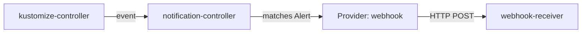

# Events, Providers And Alerts

Before you can be told about a failure, something has to record it. This part starts with the events Flux already records, then sends them out of the cluster with a `Provider` and an `Alert`, and ends with the exact payload a webhook receives. Once you have seen one event arrive, every other provider type is the same idea with a different address.

## The events Flux records

A Kubernetes **event** is a short object that a component writes about another object: what happened, when, and why. Every Flux controller writes one each time something worth reporting happens to an object it reconciles. A Flux event has four parts you will use:

| Part | What it says | Example |
| --- | --- | --- |
| Involved object | The Flux object the event is about | `Kustomization/podinfo` in `flux-system` |
| Severity | `info` for normal progress, `error` for a failure | `error` |
| Reason | A short code for what happened | `ReconciliationSucceeded`, `BuildFailed` |
| Message | The text a person reads | the objects that changed, or why the apply failed |

Read the events of the playground. `flux events` lists the events of Flux objects, newest last:

<!-- astrona:playground:renew -->

```sh
flux events -A
flux events --for Kustomization/podinfo -n flux-system
```

The first command lists events for every Flux object in every namespace: the `GitRepository` `flux-system` storing new artifacts, and the Kustomizations applying them. The second narrows the list to one object. Each line has a type, a reason, the object and a message. All of them are `Normal` here, which is what `info` looks like in Kubernetes terms, because nothing is broken yet.

## Provider and Alert

Events stay in the cluster unless notification-controller forwards them. It does that from two objects in the API group `notification.toolkit.fluxcd.io`, version `v1beta3`:

- A **`Provider`** says where to send: a type (`generic`, `slack`, `msteams` and many more) and an address.
- An **`Alert`** says what to send: a list of event sources, a minimum severity, and filters on the message. It names one `Provider`.



The diagram shows the path of one event: kustomize-controller records it, notification-controller checks it against every `Alert`, and the matching `Alert`'s `Provider` posts it to the receiver.

The simplest provider is `generic`: it sends each event as a JSON `POST` to an address. Commit a `Provider` and a first `Alert` that forwards every event from every Flux `Kustomization`. Pull your clone of `fleet` (clone it first if you have none), then save this as `fleet/clusters/kind/alerts.yaml`:

```yaml
apiVersion: notification.toolkit.fluxcd.io/v1beta3
kind: Provider
metadata:
  name: webhook
  namespace: flux-system
spec:
  type: generic
  address: http://webhook-receiver.monitoring/flux
---
apiVersion: notification.toolkit.fluxcd.io/v1beta3
kind: Alert
metadata:
  name: everything
  namespace: flux-system
spec:
  providerRef:
    name: webhook
  eventSeverity: info
  eventSources:
    - kind: Kustomization
      name: "*"
```

`name: "*"` matches every `Kustomization` in the `Alert`'s namespace, and `eventSeverity: info` forwards events of every severity. Commit, push and reconcile:

```sh
cd fleet
git add clusters/kind/alerts.yaml
git commit -m "Send Flux events to the webhook receiver"
git push
flux reconcile kustomization flux-system --with-source
```

## Read what arrives

An event only arrives when something happens, so make something happen. Change `replicas: 2` to `replicas: 3` in `fleet/apps/podinfo/deployment.yaml`, commit and push, then reconcile and read the receiver's log:

```sh
git commit -am "Scale podinfo to 3"
git push
flux reconcile kustomization podinfo --with-source
kubectl -n monitoring logs deploy/webhook-receiver --tail=60
```

The log shows a `POST` to `/flux` with a JSON body. The body holds `involvedObject` (kind `Kustomization`, name `podinfo`, namespace `flux-system`), `severity` `info`, a `reason` such as `ReconciliationSucceeded`, a `message` that lists the Deployment as configured, `metadata` with the Git revision, `reportingController` `kustomize-controller` and a `timestamp`. The request also carries a `Gotk-Component` header that names the controller. Any program that can read JSON can act on this.

## Slack and Microsoft Teams

Chat providers work the same way, but their address is a secret. Whoever holds a chat webhook address can post to the channel, so the address goes in a Secret key named `address` and stays out of Git. These two examples are for reading only, because the playground has no chat service:

```yaml
apiVersion: notification.toolkit.fluxcd.io/v1beta3
kind: Provider
metadata:
  name: teams
  namespace: flux-system
spec:
  type: msteams
  secretRef:
    name: teams-webhook   # key "address" holds the incoming webhook URL
---
apiVersion: notification.toolkit.fluxcd.io/v1beta3
kind: Provider
metadata:
  name: slack
  namespace: flux-system
spec:
  type: slack
  channel: platform-alerts
  address: https://slack.com/api/chat.postMessage
  secretRef:
    name: slack-bot-token   # key "token" holds the bot token
```

For Microsoft Teams, the whole webhook address is in the Secret. For Slack, the recommended setup uses a bot token in the Secret and the API address in `spec.address`; an `address` key in the Secret would override it. A `generic-hmac` provider adds an `X-Signature` header, an HMAC of the body keyed with a `token` from a Secret, so the receiver can check who sent the request.

You now know what an event holds, how a `Provider` and an `Alert` move it out of the cluster, and what the receiver gets. The question still open is volume: the receiver got every routine success, and on a real platform that buries the one message that matters.

## Common pitfalls

> [!WARNING]
> - **Expecting an event without a change.** Flux reports what happened. Push a commit or cause a failure to see one.
> - **Putting a chat webhook address in Git.** Use a Secret with the key `address` (or `token` for a Slack bot) and `secretRef`.
> - **Forgetting the namespace of `eventSources`.** Without `namespace`, an event source means the `Alert`'s own namespace.
> - **Reading `Normal` and `Warning` as the Flux severity.** Kubernetes shows `info` as `Normal` and `error` as `Warning`; the payload uses `info` and `error`.
