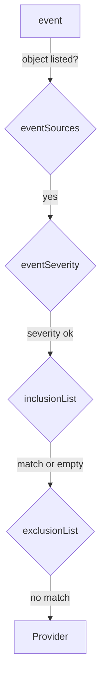

# Choosing Which Events Become Alerts

An `Alert` that forwards every event is noise. Each push, each interval and each healthy reconcile produces `info` events, and a channel full of successes teaches people to ignore the channel. This part narrows an `Alert` down to what needs action: errors, from the objects you care about, without messages you have decided to ignore. Then it proves the narrow `Alert` with a real failure.

## The four filters

An `Alert` passes an event to its `Provider` only when the event matches every filter. The four filters work in this order:

| Field | What it selects | Notes |
| --- | --- | --- |
| `eventSources` | Which objects: a `kind`, a `name` (or `"*"`), an optional `namespace`, optional `matchLabels` | Required. Without `namespace`, the `Alert`'s own namespace |
| `eventSeverity` | `info` (every event) or `error` (errors only) | Defaults to `info` |
| `inclusionList` | Regular expressions; the message must match at least one | Optional |
| `exclusionList` | Regular expressions; a message that matches any is dropped | Optional. Wins over `inclusionList` |

Two more fields shape what is sent rather than what is selected. `eventMetadata` adds key-value pairs, such as `cluster: kind`, to every event the `Alert` sends. `summary` did the same for one short text, but it is deprecated; use `eventMetadata` instead.



The diagram shows one event passing the four filters in order; a "no" at any step drops it.

## Narrow the Alert to podinfo errors

Replace the catch-all `Alert` with one for podinfo errors only. Pull first, then replace the `Alert` in `fleet/clusters/kind/alerts.yaml` so the file reads:

<!-- astrona:playground:renew -->

```yaml
apiVersion: notification.toolkit.fluxcd.io/v1beta3
kind: Provider
metadata:
  name: webhook
  namespace: flux-system
spec:
  type: generic
  address: http://webhook-receiver.monitoring/flux
---
apiVersion: notification.toolkit.fluxcd.io/v1beta3
kind: Alert
metadata:
  name: podinfo-errors
  namespace: flux-system
spec:
  providerRef:
    name: webhook
  eventSeverity: error
  eventSources:
    - kind: Kustomization
      name: podinfo
  eventMetadata:
    cluster: kind
```

The old `Alert` named `everything` disappears from Git, and the `flux-system` Kustomization prunes it from the cluster. Commit, push and reconcile, then check what the cluster now holds:

```sh
cd fleet
git commit -am "Alert only on podinfo errors"
git push
flux reconcile kustomization flux-system --with-source
kubectl -n flux-system get providers,alerts
```

Only `webhook` and `podinfo-errors` remain.

## Prove it with a real failure

A filter is only proven by an event that passes it and one that does not. Break podinfo in Git: change `path: ./apps/podinfo` to `path: ./apps/podinfo-missing` in `fleet/clusters/kind/podinfo.yaml`, push, and reconcile both Kustomizations:

```sh
git commit -am "Break podinfo on purpose"
git push
flux reconcile kustomization flux-system --with-source
flux reconcile kustomization podinfo
kubectl -n monitoring logs deploy/webhook-receiver --since=2m
```

`flux reconcile kustomization podinfo` fails, because the path does not exist in the artifact. The receiver's log shows one `POST` whose body has `severity` `error`, the `involvedObject` `Kustomization/podinfo`, a message about the missing path, and `cluster` `kind` in its `metadata`. Now repair it and watch what does not arrive:

```sh
git revert --no-edit HEAD
git push
flux reconcile kustomization flux-system --with-source
flux reconcile kustomization podinfo
kubectl -n monitoring logs deploy/webhook-receiver --since=1m
```

podinfo is `Ready` again, and the receiver got nothing new. The recovery produced `info` events, and `eventSeverity: error` dropped them. Whether people should hear about recoveries is a choice: a second `Alert` with `eventSeverity: info` and an `inclusionList` such as `"^Reconciliation finished"` would send only those.

You can now select exactly the events that need action, and prove the selection with a failure that arrives and a recovery that does not. The question still open is the other view of the same system: not one event at a time, but how Flux performs over hours and days.

## Common pitfalls

> [!WARNING]
> - **Leaving `eventSeverity` out.** It defaults to `info`, so the `Alert` forwards every success.
> - **An `exclusionList` that matches everything.** A pattern such as `".*"` drops every event, and no error can tell you so. `exclusionList` wins over `inclusionList`.
> - **Naming an object in the wrong namespace.** `eventSources` without `namespace` means the `Alert`'s namespace. Under the multi-tenancy lockdown, an `Alert` may not watch another namespace at all.
> - **Testing with `kubectl patch` on a Flux object that `flux-system` manages.** The next `flux-system` reconcile puts it back, sometimes before the failure happens. Break and repair through Git.

## Your mission: Alert A Webhook When podinfo Fails

You can now write a `Provider` and a narrow `Alert` in Git and prove them with a real failure. The graded lab gives you a cluster with the webhook receiver and no alerting at all, and asks you to commit a `Provider` named `webhook` and an `Alert` named `podinfo-errors` that deliver podinfo errors, and nothing else, to the receiver.

The lab runs in its own cluster, so first pause your playground. Nothing in it is lost:

```sh
astrona stop ats-099-playground-020-01
```

Then start the lab:

```sh
astrona run --git ssh://git@github.com/astrona-io/ATS099.git -c sections/section-020/module-01/labs/lab-01
```

The task is on the next page. Solve it on your own first. When you think you are done, send it for grading:

```sh
astrona submit -c sections/section-020/module-01/labs/lab-01
```

When the lab is done, remove it and start your playground again:

```sh
astrona destroy ats-099-lab-020-01
astrona start ats-099-playground-020-01
```
