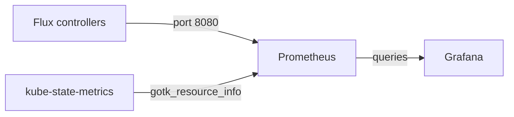

# Metrics And flux stats

An alert tells you that one thing failed, once. It does not tell you whether reconciliations are getting slower every week, or how many objects Flux manages, or whether a controller is working at all when no event arrives. Those questions need numbers over time. This part reads the Prometheus metrics the Flux controllers export, says which Flux metrics come from somewhere else, and ends with the quick summary `flux stats` prints.

## Where the controllers publish metrics

**Prometheus** is a monitoring system that fetches numbers, called **metrics**, from programs over HTTP and stores them over time. Every Flux controller serves its metrics on port `8080`, at the path `/metrics`; the container port is named `http-prom`. In a cluster with Prometheus, a `PodMonitor` selects the Flux controller pods and points Prometheus at that port.

The playground has no Prometheus, but you can read the same endpoint by hand. Forward the metrics port of kustomize-controller to your machine in a second terminal:

<!-- astrona:playground:renew -->

```sh
kubectl -n flux-system port-forward deploy/kustomize-controller 8080:8080
```

Then, in your first terminal, read the reconcile metrics:

```sh
curl -s http://localhost:8080/metrics | grep '^gotk_reconcile_duration_seconds_count'
curl -s http://localhost:8080/metrics | grep '^controller_runtime_reconcile_total'
```

The first command prints one line per Flux object that kustomize-controller has reconciled. Each line has labels for the `kind`, the `name` and the `namespace`, and a value that counts the reconciliations so far. The second prints controller-runtime counters, labelled by `controller` and by `result` (`success`, `error`, `requeue`), across all objects.

## What the reconcile metric measures

`gotk_reconcile_duration_seconds` is a **histogram**: a metric that sorts measurements into buckets and keeps a count and a sum. It comes as three series with the suffixes `_bucket`, `_count` and `_sum`. From them Prometheus can compute how long reconciliations take and how many run, per object. A sudden rise in duration usually means a large source, a slow API server or a health check that waits.

The controllers also export metrics about themselves. Among the documented ones are `gotk_cache_events_total` for the controller's cache, `rest_client_requests_total` for calls to the Kubernetes API, `workqueue_longest_running_processor_seconds` for work that is stuck, and the usual CPU and memory metrics of the process. Stop the port-forward with Ctrl-C when you are done.

## The metric that is not the controllers'

One Flux metric that dashboards use a lot is `gotk_resource_info`. It says, for each Flux object, whether it is ready, whether it is suspended, and which revision it applied. The Flux controllers do **not** export it. It comes from **kube-state-metrics**, a separate program that turns the state of Kubernetes objects into metrics, with a custom resource state configuration that the Flux monitoring setup provides. So if `gotk_resource_info` is missing, look at kube-state-metrics and its configuration, not at Flux.



The diagram shows the two sources of Flux metrics: the controllers themselves, and kube-state-metrics reading the status of the Flux objects.

## A quick summary with flux stats

For a look without Prometheus, the Flux command-line tool has `flux stats`. It is a preview command, so its output may change between versions:

```sh
flux stats -A
```

It prints one row per Flux kind: how many objects there are, how many are failing, how many are suspended, and, for sources, how much storage their artifacts use. It is a quick health check before you dig into `flux get` and `flux events`.

You now have both views of a Flux installation: events and alerts for each failure as it happens, and metrics for how the controllers behave over time. The question still open is how to combine them: an alert tells you to look, and the metrics and events tell you where.

## Common pitfalls

> [!WARNING]
> - **Looking for `gotk_resource_info` on the controllers.** It comes from kube-state-metrics with a custom resource state configuration.
> - **Scraping the wrong port.** The controllers serve metrics on `8080` (`http-prom`). The health port is a different one.
> - **Reading a counter as a rate.** `_count` and `controller_runtime_reconcile_total` only go up. Prometheus computes a rate from two samples over time.
> - **Treating `flux stats` output as stable.** It is a preview command; scripts should use `flux get` or `kubectl` with `-o json`.
