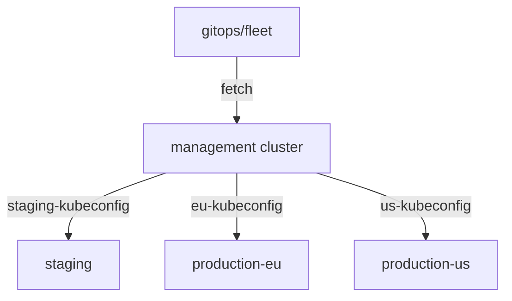

# Cluster API And Fleets Of Clusters

Building a kubeconfig by hand is fine for one staging cluster. A platform with a cluster per team, per region or per customer cannot work that way: clusters appear and disappear every week, and each one needs its credentials in the right Secret before Flux can deliver to it. This part shows how Cluster API removes that hand work, and how a repository is laid out for many clusters.

## Two ways to run Flux for many clusters

There are two common layouts, and many platforms use both.

In the **standalone** layout, every cluster runs its own Flux, bootstrapped from the same repository with its own path: `clusters/staging`, `clusters/production-eu`, `clusters/production-us`. Each Flux applies to its own cluster only. A failure in one cluster's Flux touches no other cluster, and no cluster holds another cluster's credentials.

In the **hub and spoke** layout, one management cluster runs Flux, and it delivers to the other clusters through kubeconfig Secrets, one Flux `Kustomization` per target cluster. The workload clusters run no Flux at all. Everything is managed from one place, and the management cluster holds a credential for every cluster.



The diagram shows the hub and spoke layout: one Flux on the management cluster fetches the repository once and applies to each workload cluster through that cluster's kubeconfig Secret.

## What Cluster API adds

**Cluster API** (CAPI) is a Kubernetes project that creates and manages clusters from Kubernetes objects. You apply a `Cluster` object, and its controllers create the machines, install Kubernetes and join the nodes. When the new cluster's API server is ready, Cluster API writes a Secret named `<cluster>-kubeconfig` in the namespace of the `Cluster` object, with an administrator kubeconfig under the key `value`.

That is exactly the shape a Flux `Kustomization` reads. The Flux documentation describes the pattern: put the Flux `Kustomization` in the same namespace as the `Cluster` object, and set `kubeConfig.secretRef.name` to `<cluster>-kubeconfig`. You can commit the `Cluster` and the `Kustomization` together; Flux keeps retrying until the Secret exists and the API server answers, then applies.

```yaml
apiVersion: kustomize.toolkit.fluxcd.io/v1
kind: Kustomization
metadata:
  name: staging-addons
  namespace: clusters
spec:
  interval: 10m
  sourceRef:
    kind: GitRepository
    name: fleet
  path: ./addons/base
  prune: true
  kubeConfig:
    secretRef:
      name: staging-kubeconfig
```

This example is for reading; the playground has no Cluster API. It assumes a `Cluster` named `staging` in the namespace `clusters`, and a `GitRepository` named `fleet` in the same namespace. The Cluster API kubeconfig is an administrator credential for the new cluster. A common first delivery creates a narrower account on that cluster, the way `flux-deployer` was set up by hand in the playground, and later deliveries use it.

## Laying out the repository

Whichever layout you pick, the repository follows the same idea: shared definitions once, a small folder per cluster.

| Folder | What it holds |
| --- | --- |
| `apps/<app>/base` | The application, the same for every cluster |
| `apps/<app>/<environment>` | Kustomize overlays: replicas, images, settings per environment |
| `clusters/<cluster>/` | What one cluster runs: Flux `Kustomization` objects that point at `apps/...` and `infrastructure/...` |
| `infrastructure/` | Cluster add-ons: ingress, certificates, monitoring |

A new cluster is then a new folder under `clusters/`, plus, in the hub and spoke layout, a `Cluster` object and its kubeconfig Secret. Removing a cluster is deleting its folder and its `Cluster` object.

You now know the two ways to run Flux for many clusters, how Cluster API hands Flux a kubeconfig for each cluster it creates, and how to lay out a repository for a fleet. The question still open is what happens when a cluster, or Flux on it, is lost, and how much of it Git can bring back.

## Common pitfalls

> [!WARNING]
> - **Putting the Flux `Kustomization` in a different namespace from the `Cluster`.** The kubeconfig Secret is in the `Cluster`'s namespace, and `secretRef` only looks in the `Kustomization`'s own namespace.
> - **Using the Cluster API administrator kubeconfig for everything.** It holds full rights on the workload cluster. Create narrower accounts for routine delivery.
> - **One folder for every cluster.** Without a folder per cluster, a change meant for staging reaches production.
> - **Forgetting that the hub holds every credential.** In the hub and spoke layout, protect the management cluster like the most sensitive cluster you have.
