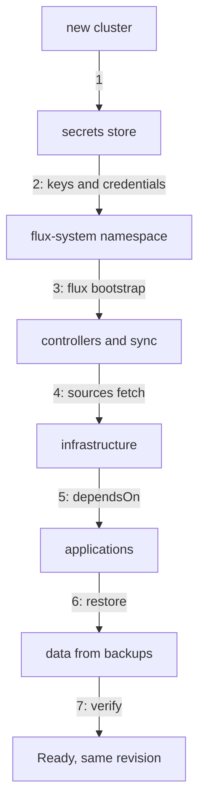

# Rebuilding A Lost Cluster

The hardest case is not a broken Flux but a missing cluster: the cloud account was closed, the control plane was lost, or the cluster must be rebuilt in another region. Git still holds the desired state, and a new cluster can reach it. Whether the rebuild takes an hour or a day depends almost entirely on the order of the steps. This part sets out that order and explains why each step comes where it does.

## The order of a rebuild

A rebuild has one rule: every credential and key Flux needs must be in place before Flux needs it. Flux retries failed objects forever, so a wrong order does not break the rebuild, but every object behind a missing credential waits, and the error messages bury the real problem.

The diagram shows the seven steps in order, from an empty cluster to a verified one.

Each step has a reason:

1. **Create the cluster** with the same Kubernetes version range Flux supports. Flux 2.9 needs Kubernetes 1.34.1 or later.
2. **Restore keys and credentials first.** The decryption key for encrypted files, the credentials for any second source, and kubeconfigs that Cluster API will not recreate. Create the namespace `flux-system` yourself if the Secrets go there.
3. **Run `flux bootstrap`** against the same repository, branch and path as before. It recreates the Secret `flux-system` from the token or key you pass it, installs the controllers from `gotk-components.yaml` in Git, and applies the sync objects.
4. **Let the sources fetch.** `flux get sources all -A` shows every source `Ready` once its credential is there.
5. **Let `dependsOn` order the rest.** Infrastructure such as CRDs, ingress and certificates comes before the applications that need it. That order lives in Git, in the `dependsOn` fields, so nobody has to remember it during the outage.
6. **Restore data** from backups. Flux recreates PersistentVolumeClaims from Git, empty.
7. **Verify**: every Flux object `Ready`, at the revision Git holds now, and the workloads answering.

## What changes on a new cluster

On a new cluster no workload survived, so there is nothing to adopt: every object is created fresh and gets a new UID. Two things deserve a check after the rebuild. Anything created by hand on the old cluster, outside Git, is simply gone; a rebuild is the moment you find those objects. And a `suspend: true` committed to Git during some old maintenance window is applied again, so that part of the cluster stays paused on the new cluster too.

## Practise it before you need it

A recovery that has never been run is a guess. The cheap way to practise is the one you used in the playground: uninstall Flux and bring it back, then check UIDs and inventories. The next level is a scheduled rebuild drill on a throwaway cluster from the same repository, with a stopwatch, a written list of every Secret that had to be restored by hand, and a fix in Git for every surprise. Each drill should end with a shorter list.

You now have the order for a full rebuild and the reason for each step. The open question for your own platform is the list in step 2: which credentials and keys does your Flux need from outside Git, and where do they live today?

## Common pitfalls

> [!WARNING]
> - **Bootstrapping before the keys are back.** Everything that needs a missing credential waits and fills the events with errors that hide the real cause.
> - **Rebuilding from a different path.** The new cluster then runs a different folder of the repository than the old one did.
> - **Assuming data comes back.** Git and Flux restore objects, not the bytes in volumes.
> - **Never running the drill.** The first rebuild should not happen during an outage.
